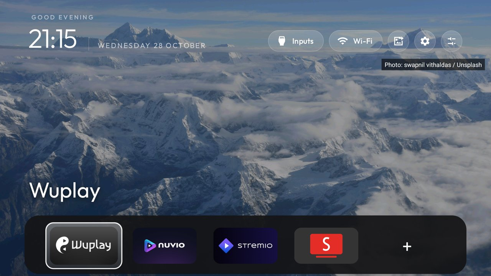
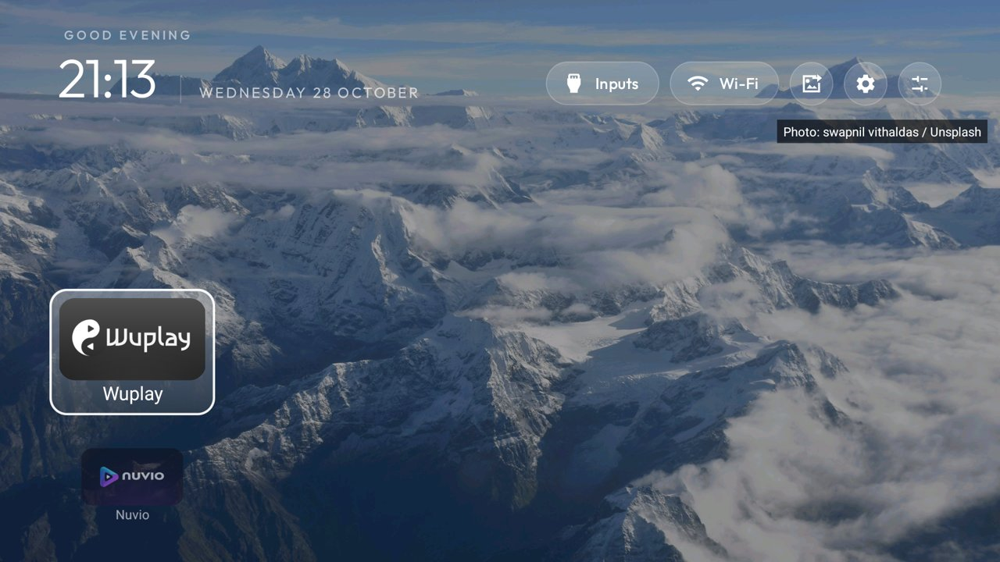
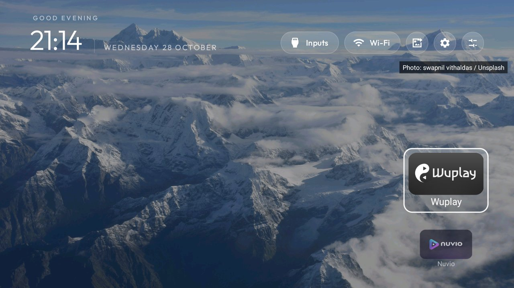
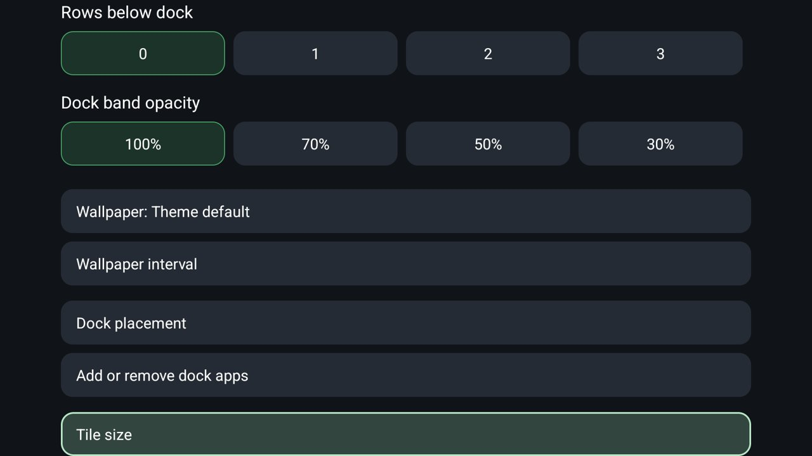
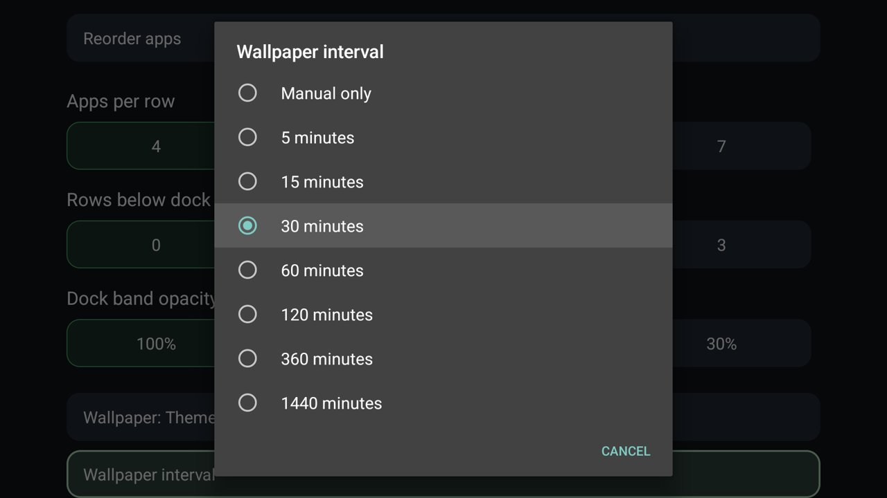

# The gethari fork

This is an enhanced fork of [Gathin23/cleanyourtv](https://github.com/Gathin23/cleanyourtv).
It keeps the original native Java launcher and Apple TV styling, adding personal wallpaper
and dock controls. The current integration includes upstream `095b71ad` from 28 October 2026.
Upstream retains credit for the launcher, TV cleanup tools, themes and device research.

## What this fork adds

| Area | Upstream | This fork |
|---|---|---|
| Wallpaper sources | Local pictures, collections, rotation and captions | Also fetches landscape photos from your own Unsplash collections, caches the last image and shows photographer attribution |
| Wallpaper controls | Theme rotation and on-TV image picker | A next-wallpaper icon, plus an on-TV interval picker: manual, 5, 15, 30, 60, 120, 360 or 1440 minutes |
| Tile size | Changes with columns and available space | Independent 50–100% sizing, keeping the number of apps per row separate |
| Dock placement | Theme grid and horizontal dock options | A compact bottom-edge dock and left/right vertical carousels with a larger focused tile and smaller neighbors |
| Dock editing | Edit dock and reorder modes | Also a checkbox app picker, an add tile, and hold-OK actions to remove or move shortcuts immediately |
| Settings shortcuts | Configurable settings entry point | Separate sliders for launcher settings, gear for TV system settings, and picture/arrow for the next wallpaper |
| TCL gear and Home | Configurable remote helpers | A tested configuration that retains the Google TV dashboard while redirecting its Home activity to this launcher |

The carousel and compact dock keep banner artwork, a glass focus highlight and the original dark
Apple TV style. The compact bottom dock shows a large selected-app name above the band.
Removing a dock shortcut never uninstalls the app. Dock app choices persist across app updates and
layout changes; they are independent of wallpaper credentials.

## Screenshots from the TV

| Bottom-edge dock | Left carousel |
|---|---|
|  |  |

| Right carousel | On-TV controls |
|---|---|
|  |  |

Screenshots are taken on a TCL Google TV, with no account details or Wi-Fi names. The landscapes
shown in the screenshots are from Unsplash; each image displays its photographer attribution.
The earlier theme preview shows [Sreehari Devadas on Unsplash](https://unsplash.com/photos/R5ZCRi_Snpg).
The photographs remain subject to the [Unsplash license](https://unsplash.com/license); it is not
relicensed under this repository's code license.



## Use the controls

Open the sliders icon for Launcher settings:

- **Dock placement** selects Theme layout, Bottom edge, Left carousel or Right carousel.
- **Tile size** changes the artwork size without changing the number of columns.
- **Add or remove dock apps** opens a checkbox list; choose apps and Save.
- **Wallpaper interval** controls automatic switching; Manual only keeps the next-wallpaper button available.
- The original **Tile row position** applies to Theme layout. Bottom edge stays low; side docks center their focused tile.

On a compact or side dock, hold OK on an app for Remove from dock, Move earlier, Move later and
Add apps. The add tile opens the same app picker. Side docks use Up/Down and wrap at either end;
press toward the center of the screen to reach the toolbar. Bottom docks use Left/Right and Up
returns to the toolbar. The sliders, gear and picture/arrow icons have separate accessibility labels.

A specific local wallpaper chosen in the original Wallpaper picker overrides Unsplash until you
choose Theme default. Follow theme resets layout and interval overrides, while retaining the dock's
app membership and private Unsplash credentials.

## Build and update

Use JDK 17, Android SDK platform 34 and build-tools 34.0.0, as upstream does:

```bash
cd launcher
./gradlew testReleaseUnitTest lintRelease assembleRelease
adb -s <tv-endpoint> install -r app/build/outputs/apk/release/app-release.apk
adb -s <tv-endpoint> shell cmd package set-home-activity com.gathin.tvhome/.MainActivity
```

An in-place update keeps the launcher's private credentials and settings. Do not uninstall it first.
Some firmware leaves the Home accessibility helper enabled but unbound after an APK replacement.
If Home briefly returns to Google TV, open TV Accessibility settings and toggle this launcher's
Home button service off and on, then confirm both physical Home and Settings buttons again.
Apply `themes/tcl-q6k/config.json` using the existing theme tools for the personal dock controls,
or set `dock_placement` to `1`, `2` or `3` in your own theme. The included TCL theme contains example
app package choices: use the on-TV app picker to replace them with your own.

## Optional Unsplash setup

This fork adds Android's `INTERNET` permission. Upstream's launcher deliberately stays offline;
if you prefer that constraint, use upstream. In this fork no Unsplash request is made until your
own API access key and collection IDs have been provisioned. Local wallpapers continue to work.

Create an Unsplash application and put its access key in a local environment file outside the
repository. The secret key is not needed. Never commit the environment file or a setup payload.

```text
UNSPLASH_ACCESS_KEY=your_own_access_key
```

Validate the collections and provision the TV:

```bash
python3 tools/unsplash-setup.py \
  --env-file /path/outside/repository/unsplash.env \
  --collections collection_id,another_collection_id \
  --serial <tv-endpoint>
```

Restart the launcher to import the temporary setup file into private application storage. The
staging file is deleted after a successful import. Existing credentials survive APK upgrades;
provision them only when changing the key or collection. The tool validates that each collection
is accessible and contains photos, and never evaluates the environment file as shell code.
The TV downloads screen-sized photos, records the API download event and displays photo credits.
Network failures retain the cached image and retry later. Choose a reasonable interval for your
own Unsplash application's rate limit.

## TCL's original Settings overlay

The original Google TV dashboard is part of `com.google.android.apps.tv.launcherx`. Disabling that
package removes the overlay too. On the tested TCL firmware it must stay enabled, with this launcher
selected as Home and `stock_home_redirect` set to that package in the theme. Enable the existing
Home-key accessibility service so a firmware-routed Google Home activity returns here. The included theme opts into upstream’s service repair; grant `android.permission.WRITE_SECURE_SETTINGS` over ADB for the launcher to restore its recorded helper after a force stop or update. Keep
`settings_key_keycodes` empty: mapping TCL key 83 to Android Settings replaces the native overlay
with the full settings page. Do not disable TV input, remote or settings services.

This configuration depends on firmware; other TVs may need the upstream remote-key settings.
The separate toolbar gear opens TV system settings. Google TV protects its dashboard with a system permission, so the original overlay is reached through the physical remote’s gear button.

## Upstream compatibility

Changes are kept on top of upstream instead of replacing its device lists, safeguards or tooling.
The original grid remains available as Theme layout. The added controls currently use English labels in every locale; upstream translations remain intact. Local collection ordering, wallpaper captions,
the image picker, module cards and the native input controls remain in the codebase.

This fork is a separate product choice: network permission and the extra dock UI go beyond the
minimal offline upstream launcher. Builds and tests are reproducible from source; credentials,
TV backups, raw screenshots, APKs and machine-specific SDK paths stay out of Git.
